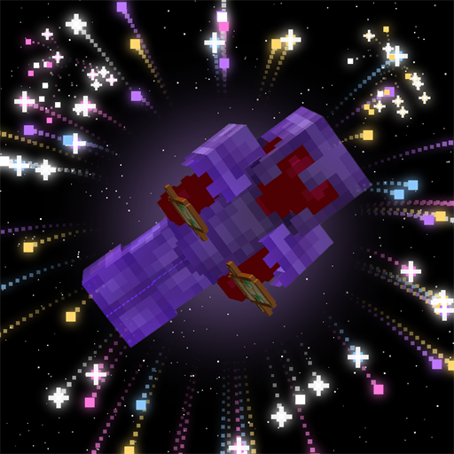

# kill effects

client side fabric mod for minecraft 1.21.11. when you kill a mob or a player, an effect plays where they died.

effects: lightning (only visual, no damage), firework, totem of undying, blood and soul fire. you can turn on as many as you want and they all play together, or turn on random effect and it picks one every kill. the firework has 10 colors and a custom hex one. there is also an optional kill sound with a volume slider.

a kill only counts if you hit the thing in the last 3 seconds. end crystal kills count too if you hit the crystal. stuff that dies to other people or commands does nothing.

## settings

open mod menu, find kill effects and click config. you can pick the effects, turn them on for players and/or mobs, pick the sound and set the volume. there is also a key in controls called toggle kill effects, it has no key set by default. the config file is config/klfx.json.

## install

you need fabric loader 0.19 or newer, fabric api, cloth config and mod menu. put the jar from the releases page in your mods folder.

## build

`./gradlew build`, the jar ends up in build/libs.

all rights reserved. made by wysss.